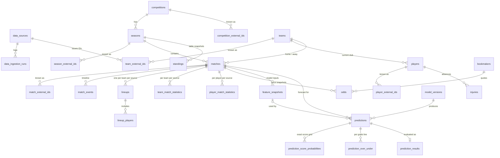

# Database schema

PostgreSQL 17. The schema is defined by the SQLAlchemy models in
`backend/app/models/` and created by the Alembic migration in
`backend/alembic/versions/`. This document explains the structure and the
decisions behind it. The models are the source of truth for column-level detail.

## Overview

28 tables in six groups:

| Group | Tables |
| ----- | ------ |
| Providers and ingestion | `data_sources`, `data_ingestion_runs` |
| Core football entities | `competitions`, `seasons`, `teams`, `players`, `matches` |
| Provider ID mappings | `competition_external_ids`, `season_external_ids`, `team_external_ids`, `player_external_ids`, `match_external_ids` |
| Match data (per provider) | `match_events`, `lineups`, `lineup_players`, `team_match_statistics`, `player_match_statistics`, `injuries`, `odds`, `bookmakers`, `standings` |
| Data quality | `data_quality_issues` (see [historical-pipeline.md](historical-pipeline.md)) |
| Modelling | `feature_snapshots`, `model_versions`, `predictions`, `prediction_score_probabilities`, `prediction_over_under`, `prediction_results` |

## Entity relationships



Every row in a provider-data table (events, lineups, statistics, injuries, odds,
standings) also references `data_sources`. Those edges are left out of the diagram
for readability.

## Key design decisions

### Canonical entities and provider IDs

Competitions, seasons, teams, players and matches are **canonical**: one row per
real-world thing, whatever the number of providers. Provider identifiers live in
`<entity>_external_ids` tables:

| column | meaning |
| ------ | ------- |
| `<entity>_id` | the canonical row (CASCADE on delete) |
| `data_source_id` | the provider (`data_sources`, RESTRICT on delete) |
| `external_id` | the provider's own ID, stored as text |

Two unique constraints:

- `(data_source_id, external_id)`: a provider ID resolves to exactly one entity.
- `(<entity>_id, data_source_id)`: an entity has at most one ID per provider.

This meets the "provider name + external ID" requirement without storing the
provider name on every row. It also means adding a second provider later links
new IDs to existing teams instead of creating duplicate teams.

### Provider observations

Events, lineups, statistics, injuries, odds and standings are **observations**: what
one provider reported. Each row carries `data_source_id` and an optional
`external_id` (unique per provider when present; `NULL`s never collide). The
provider is part of each natural key, so two providers can report the same
match's statistics side by side for comparison or reconciliation.

| Table | Natural key |
| ----- | ----------- |
| `team_match_statistics` | match, team, source |
| `player_match_statistics` | match, player, source |
| `lineups` | match, team, source |
| `lineup_players` | lineup, player |
| `standings` | season, group, team, source, as-of date (NULLS NOT DISTINCT) |
| `odds` | match, bookmaker, source, market, selection, line, recorded at (NULLS NOT DISTINCT) |
| `injuries` | player, source, match, start date (NULLS NOT DISTINCT) |

`NULLS NOT DISTINCT` (PostgreSQL 15+) makes a missing group, line or date compare
equal, so a snapshot cannot be inserted twice just because an optional column is
NULL.

### Matches

- `status`: `scheduled`, `live`, `finished`, `postponed`, `suspended`, `cancelled`,
  `abandoned`.
- `home_score`/`away_score` hold the result after regular and extra time. Half-time
  and penalty-shootout scores are separate nullable pairs.
- `competition_id` is stored for fast filtering, and a **composite foreign key**
  `(season_id, competition_id) → seasons(id, competition_id)` guarantees it always
  matches the season's competition.
- Checks: a team cannot play itself; each score pair is both NULL or both set and
  never negative; a `finished` match must have a score.
- `UNIQUE (home_team_id, away_team_id, kickoff_at)` stops the same fixture being
  inserted twice.
- `venue` and `referee` are free text for now.

### Statistics

Common statistics (possession, shots, shots on target, corners, fouls, cards,
saves, passes, xG, and for players minutes, goals, assists, xA and rating) are
**typed, nullable columns**. NULL means "not reported", which is different from 0.
Anything else goes into `extra` (JSONB), to be promoted to a column once several
providers supply it.

**xGA is not stored.** A team's xGA in a match equals its opponent's
`expected_goals` for the same match and source:

```sql
SELECT s.team_id, s.expected_goals AS xg, o.expected_goals AS xga
FROM team_match_statistics s
JOIN team_match_statistics o
  ON o.match_id = s.match_id AND o.data_source_id = s.data_source_id
 AND o.team_id <> s.team_id;
```

### Model registry

`model_versions` records each trained model (algorithm, feature and dataset
versions, training period, competitions, hyperparameters, metrics, artifact) and
`model_activations` records which version was active when, with the version it
replaced and whether the change was a rollback. Partial unique indexes allow one
active version and one open activation per model name. See
[model-registry.md](model-registry.md).

### Predictions

- `predictions` holds one model version's forecast for a match at `predicted_at`.
  It stores the most likely score (`predicted_home_goals`/`predicted_away_goals`),
  expected goals, home/draw/away probabilities (a CHECK requires them to sum to 1
  ± 0.00001) and the BTTS probability. Rows are immutable; re-predicting creates a
  new row with a later `predicted_at`.
- `prediction_score_probabilities` holds the exact-score distribution, one row per
  `(home_goals, away_goals)` cell. Being relational, the most likely score or the
  probability of a given score is a plain indexed query.
- `prediction_over_under` holds over/under probabilities per goals line (1.5, 2.5, …).
  Over and under are stored separately because on whole-number lines the total
  can land exactly on the line (a push), so they may sum to less than 1.
- `prediction_results` is one-to-one with `predictions` (the primary key is
  `prediction_id`). It stores evaluation metrics: outcome, exact-score and BTTS
  correctness, Brier score, log loss, ranked probability score, and the
  probability given to the actual score. The actual score is **not** copied; it
  is read from `matches`.
- `feature_snapshots` stores the exact feature vector and `data_cutoff_at` used
  for a prediction, making it reproducible and auditable for leakage.
- `model_versions` is unique on `(name, version)`. A partial unique index allows
  at most one active version per model name.

### Conventions

- **Keys:** `bigint GENERATED ALWAYS AS IDENTITY` surrogate keys. Pure child tables
  (score grid, over/under, results) use composite natural primary keys.
- **Types:** `text` for strings, `timestamptz` for instants (UTC), `date` for
  calendar dates, `numeric` for odds, probabilities and xG (exact decimals), and
  `smallint` for counts and scores.
- **Enumerations:** text columns with CHECK constraints (e.g. `ck_matches_match_status`)
  rather than native PostgreSQL enums, which cannot drop values and are awkward to
  migrate. Python-side they are `StrEnum`s in `app/models/enums.py`.
- **Timestamps:** `created_at` on every table except the two probability tables
  under a prediction (score grid, over/under), which are written with it. `updated_at` on tables whose rows are edited in place (entities,
  statistics, lineups, standings, injuries). Append-only tables (predictions,
  odds, events, feature snapshots, ID mappings) have only `created_at`.
  Ingestion runs record `started_at`/`finished_at` instead. `updated_at` is set by
  the ORM, so bulk SQL updates must set it explicitly.
- **Deletes:** provider data and ID mappings cascade from their match or entity.
  References to canonical entities, data sources and model versions use
  RESTRICT, so nothing that is referenced can disappear silently. Predictions
  block match deletion.
- **Indexes:** every foreign key is the leading column of some index (enforced by a
  test). Extra composite indexes support the expected access paths, e.g. a team's
  matches by kickoff, a competition's fixtures by date, and odds by match.
- **Constraint names** follow the naming convention in `app/db/base.py`
  (`uq_<table>_<columns>`, `ck_<table>_<name>`, …). Long natural keys are named
  `uq_<table>_natural_key`, ready for `INSERT … ON CONFLICT ON CONSTRAINT`.

## Working with migrations

```bash
cd backend
alembic upgrade head                                   # apply
alembic revision --autogenerate -m "add venues table"  # after changing models
alembic check                                          # fails if models and migrations differ
```

Review every autogenerated migration before committing it. The test suite also
fails if the models and migrations drift apart
(`tests/db/test_migrations.py::test_migrated_schema_matches_models`).

## Tests

`backend/tests/db/` runs against a real PostgreSQL. The session fixture creates
`<POSTGRES_DB>_test`, applies the migrations, and drops it afterwards. Each test
runs in a transaction that is rolled back. Run with:

```bash
docker compose up -d --wait postgres
cd backend && RUN_INTEGRATION_TESTS=1 pytest tests/db
```

## Known limitations

- **Cross-table rules the schema cannot express are not enforced yet.** For
  example, a statistics or lineup row's `team_id` should be one of the match's two
  teams, and a match's teams should belong to its competition. The ingestion layer rejects records it
  cannot resolve, so what it imports is consistent, but nothing stops a bad row
  inserted by hand or by a future writer. Database triggers would close that.
- **`updated_at` is maintained by the ORM**, not a database trigger. Raw SQL updates
  must set it explicitly.
- **`venue` and `referee` are free text on `matches`.** Promote them to tables if
  they become model features (e.g. referee card tendencies).
- **Statistics are full-match only.** Per-half statistics would need a `period`
  column in the natural key.
- **Squad membership over time is not modelled.** Only `players.current_team_id`
  and per-match lineups exist.
- **`odds` will be the largest table.** Consider range-partitioning it by
  `recorded_at` once it reaches tens of millions of rows.
- **Matching the same real-world entity across providers** (e.g. deciding that two
  providers' teams are the same club) is an ingestion concern. The schema supports
  it, but no matching logic exists yet.
- **Exact-score probabilities are not checked to sum to 1 across cells**, since a
  CHECK constraint cannot span rows. Validate this where predictions are written.
